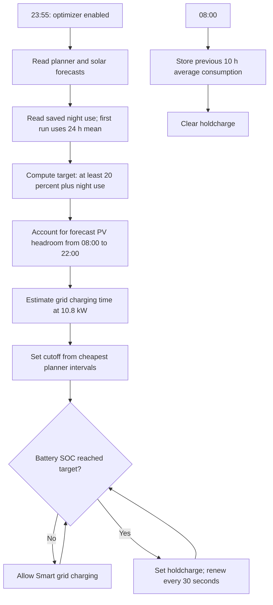

# evcc Price Optimization

[Deutsche Version](EVCC_PREISOPTIMIERUNG.md)

## Requirements

- The evcc planner tariff must be configured to use electricity prices.
- The `sensor.synboxen_forecast_planner` and `sensor.synboxen_forecast_solar` entities must be enabled in Home Assistant. The evcc site solar forecast should include the forecasts configured in evcc for both roof orientations (SynSolar and SynSolar+).
- The smart price limits for SynBox-01, SynBox-02, and the home battery must be available in evcc.
- The `select.synboxen_battery_mode` entity must be enabled so Home Assistant can renew the temporary charge lock.

## Operation

The **evcc Price Optimization Enabled** switch (`input_boolean.evcc_smart_price_optimizer`) enables or pauses the automation. It is listed with the Home Assistant helpers. A newly created switch starts off; Home Assistant restores its previous state after restarts.

When enabled, the automation calculates price limits and a battery target daily at 23:55 for the following day. EPEX day-ahead data is typically available by then. The optimization evaluates the rolling 24-hour window:

- Wallboxes: the cutoff for the four cheapest hours in total. The same value is applied to SynBox-01 and SynBox-02.
- Home battery: the target state of charge accounts for the previous night's average consumption, the aggregated solar forecast from both roof orientations for the following day from 08:00 to 22:00, and a minimum 20% reserve for the 22:00–08:00 period. This plans enough energy for overnight use while leaving room for expected PV generation. The current battery state of charge and capacity are included. Required grid-charging time is converted into the cheapest planner intervals using an assumed maximum charging power of 10.8 kW.

The evcc planner forecast already includes surcharges and VAT (gross price) and is used unchanged. The thresholds are rounded up to evcc's 0.005 EUR/kWh step size. In Smart mode, evcc charges from the grid when the planner price does not exceed the relevant limit. Once the battery target is reached, Home Assistant sets evcc's temporary **lock charging** mode every 30 seconds; the mode expires automatically after 60 seconds. The lock is not renewed while the battery is below its target and is cleared at 08:00.

At 08:00, Home Assistant stores the house-power average from the previous ten hours as a baseline. At 23:55 this value is scaled to the remaining hours until 08:00. Three seven-day statistics also track Fronius house power at night while Home Connect appliances are active or idle, and the number of active appliances. Only after at least 99% time coverage is available does the automation estimate typical incremental power per appliance and project it using the remaining program times until 08:00. Until then, it uses the existing consumption estimate. On the first run, it uses the 24-hour average instead of a saved night value. The assumed charging power is a measured peak; if actual charging power is lower, evcc may need more low-price intervals. If a forecast is unavailable, has too few intervals, or produces invalid price limits, existing price limits are left unchanged and the battery target is set to 0. Changing the switch takes effect at the next calculation.

The 23:55 run only stores the planned grid-charge price in `input_number.evcc_battery_grid_charge_price`. A further automation checks every minute how many minutes at or below that price remain. The evcc grid-charge limit is released only when that time is barely enough for the battery target (charge time at 10.8 kW plus a 30-minute reserve) and is cleared afterwards. During long cheap periods the battery therefore supplies the house and is recharged shortly before the period ends, instead of staying in `charge` mode.

## Discharge hold for price peaks

While the **evcc Price Optimization Enabled** switch is on, a further automation checks every 30 seconds whether home-battery discharging should be blocked. It assigns the remaining energy above 20% to the most expensive intervals of the next 24 hours. Grid import per interval is the average house load (`sensor.evcc_hausleistung_24h_mittel`) minus the PV forecast. The lowest price among those intervals is the peak-price threshold.

- Discharging is blocked (evcc mode `hold`) when the battery is at or below 50%, discharges at more than 100 W, and the current price is more than EUR 0.02/kWh below the threshold.
- The block is renewed every 30 seconds because evcc resets the mode after 60 seconds.
- It is released when the current price reaches the threshold, or the state of charge drops below 20% or rises above 50%.
- The helper `input_boolean.evcc_battery_discharge_hold` records that the block was set by this automation. Only then is it released again.
- If the night charge guard has set `holdcharge`, the automation does not intervene.

The start limit (50%), reserve (20%), and margin (EUR 0.02/kWh) are variables at the top of the automation.

## Flow

## Configuration

The helpers are defined in `configuration.yaml`; the automations are in `automations.yaml`. Entity IDs used by the configuration:

- `sensor.synboxen_forecast_planner`
- `number.synboxen_synbox_01_smart_cost_limit`
- `number.synboxen_synbox_02_smart_cost_limit`
- `number.synboxen_battery_grid_charge_limit`
- `sensor.synboxen_forecast_solar`
- `sensor.solarnet_leistung_verbrauch`
- `sensor.synboxen_battery_soc`
- `sensor.synboxen_battery_capacity`
- `select.synboxen_battery_mode`
- `input_number.evcc_night_consumption_kwh`
- `input_number.evcc_battery_target_soc`
- `sensor.synboxen_battery_power`
- `sensor.evcc_hausleistung_24h_mittel`
- `input_boolean.evcc_battery_discharge_hold`
