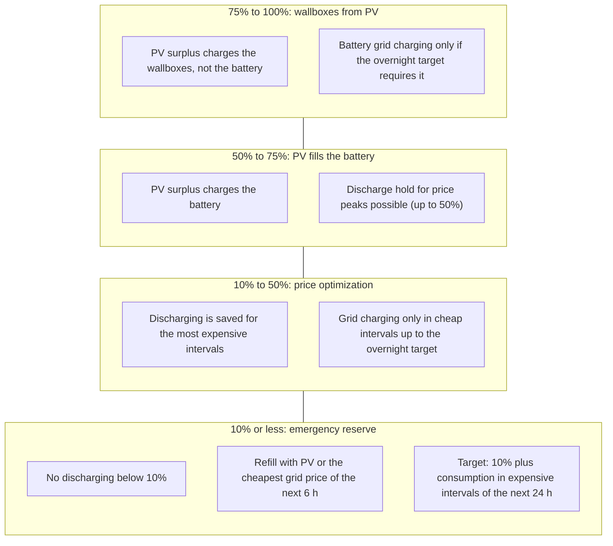
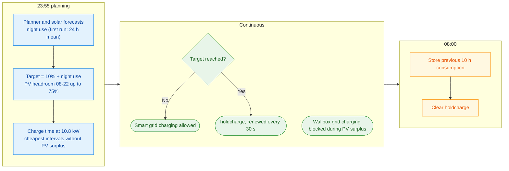

# evcc Price Optimization

[Deutsche Version](EVCC_PREISOPTIMIERUNG.md)

## Requirements

- The evcc planner tariff must be configured to use electricity prices.
- The `sensor.synboxen_forecast_planner` and `sensor.synboxen_forecast_solar` entities must be enabled in Home Assistant. The evcc site solar forecast should include the forecasts configured in evcc for both roof orientations (SynSolar and SynSolar+).
- The smart price limits for SynBox-01, SynBox-02, and the home battery must be available in evcc.
- The `input_number.evcc_wallbox_cost_limit` helper from `configuration.yaml` must be loaded. It stores the planned wallbox limit.
- The `select.synboxen_battery_mode` entity must be enabled so Home Assistant can renew the temporary charge lock.

## Operation

The **evcc Price Optimization Enabled** switch (`input_boolean.evcc_smart_price_optimizer`) enables or pauses the automation. It is listed with the Home Assistant helpers. A newly created switch starts off; Home Assistant restores its previous state after restarts.

When enabled, the automation calculates price limits and a battery target daily at 23:55 for the following day. Running it manually recalculates the values immediately. EPEX day-ahead data is typically available by 23:55. The optimization evaluates the rolling 24-hour window:

- Wallboxes: the cutoff for the four cheapest hours in total outside forecast PV-surplus intervals. An interval is excluded when forecast solar power exceeds average house load by more than 500 W. The calculated value is stored in `input_number.evcc_wallbox_cost_limit`; a separate minute automation controls the effective evcc limits.
- Home battery: the target state of charge accounts for the previous night's average consumption, the aggregated solar forecast from both roof orientations for the following day from 08:00 to 22:00, and the 10% emergency-power reserve for the 22:00–08:00 period. Because PV surplus serves the wallboxes above 75% state of charge during the day, the battery offers headroom for PV generation only up to 75%. This plans enough energy for overnight use while leaving room for expected PV generation. The current battery state of charge and capacity are included. Required grid-charging time is converted into the cheapest planner intervals using an assumed maximum charging power of 10.8 kW.

The evcc planner forecast already includes surcharges and VAT (gross price) and is used unchanged. The thresholds are rounded up to evcc's 0.005 EUR/kWh step size. In Smart mode, evcc charges from the grid when the planner price does not exceed the relevant limit. The wallbox PV automation blocks grid charging when measured PV surplus exceeds 500 W by setting both Smart limits to `-0.5`. Below 200 W surplus, it restores the planned value from `input_number.evcc_wallbox_cost_limit`. This hysteresis avoids rapid toggling. Measured surplus is calculated as `sensor.synboxen_pv_power` minus `sensor.synboxen_home_power`.

The battery scheduler checks every minute how many planner minutes remain at or below the planned battery price. It releases the grid-charge limit only when the remaining cheap time through the next 08:00 is barely enough for the required charging time at 10.8 kW plus a 30-minute reserve. Cheap intervals after the overnight charging window no longer delay charging. Grid charging is not started while measured PV surplus remains above the hysteresis threshold. Once the battery target is reached, Home Assistant sets evcc's temporary **lock charging** mode every 30 seconds; the mode expires automatically after 60 seconds. The lock is not renewed while the battery is below its target and is cleared at 08:00.

The **Energiestatistiken** sidebar dashboard visualizes consumption, generation, and grid price; see [Energy statistics dashboard](#energy-statistics-dashboard) for details. Wallbox power is subtracted from evcc house power for the house-consumption statistics.

At 08:00, Home Assistant stores the house-power average from the previous ten hours as a baseline. At 23:55 this value is scaled to the remaining hours until 08:00. Three seven-day statistics also track evcc house power (excluding wallboxes) at night while Home Connect appliances are active or idle, and the number of active appliances. Only after at least 99% time coverage is available does the automation estimate typical incremental power per appliance and project it using the remaining program times until 08:00. Until then, it uses the existing consumption estimate. On the first run, it uses the 24-hour average instead of a saved night value. The assumed charging power is a measured peak; if actual charging power is lower, evcc may need more low-price intervals. If the solar forecast is missing or has too few intervals, the battery target is still calculated without a PV-headroom allowance (at least overnight consumption plus the 10% emergency reserve). A planner outage or too few qualifying cheap intervals can prevent a new price limit from being written; the last stored value is retained. Changing the switch takes effect at the next calculation.

The 23:55 run stores the planned battery grid-charge price in `input_number.evcc_battery_grid_charge_price` and the planned wallbox limit in `input_number.evcc_wallbox_cost_limit`. These helpers are plan values, not necessarily the currently active evcc limits. The wallbox limits are `number.synboxen_synbox_01_smart_cost_limit` and `number.synboxen_synbox_02_smart_cost_limit`; during PV surplus they may temporarily be `-0.5`. Check the values and states in Home Assistant under **Developer Tools → States**. Manually running the daily automation recalculates the plan values immediately.

## Energy statistics dashboard

The dashboard is defined in `lovelace_evcc_energie.yaml` and registered as a YAML dashboard in `configuration.yaml` under `lovelace.dashboards.evcc-energie`. It is a full-width panel view with two ApexCharts cards stacked vertically. YAML dashboards cannot be edited graphically in Home Assistant; edit the file and reload the page.

| Card | Period | Content |
| --- | --- | --- |
| 14-Tage-Verbrauchsstatistik (kWh) | last 14 days, daily totals, columns | house consumption excluding wallboxes, wallboxes, grid import, battery discharge, PV production |
| 24-Stunden-Energieverbrauch und Netzpreis (15 min) | last 24 hours, per 15 minutes | the same quantities as energy difference per interval; grid price (`sensor.synboxen_forecast_planner`) as an area on its own €/kWh axis |

Daily values come from long-term statistics (`statistics` with `type: change`, `period: day`). The 24-hour card calculates the difference (`group_by.func: delta`) from history. Wallbox energy comes from `sensor.evcc_wallbox_energy_total` in the daily view and from `sensor.evcc_wallbox_energy_integrated` (integrated wallbox power) in the 24-hour view; the two may differ slightly. All entities used must keep long-term statistics (`state_class` set).

### Usage

- Clicking a legend entry permanently hides or shows the series (`apex_config.legend.onItemClick.toggleDataSeries`).
- Hovering over a legend entry highlights the series (`apex_config.legend.onItemHover.highlightDataSeries`).
- Hidden series may reappear on a refresh (`update_interval`).

### Customization

| Setting | Location in the YAML file |
| --- | --- |
| Chart height (default 420 px) | `apex_config.chart.height` per card |
| Series color | `color` per series |
| Area/line/column rendering | `type` (`area`, `line`, `column`) per series |
| Line width, area opacity | `stroke_width`, `opacity` per series |
| Refresh | `update_interval` per card |
| Period of the daily view | `graph_span` of the first card |

The `custom:apexcharts-card` must be registered as a dashboard resource `/local/apexcharts-card.js?v=2.2.3` (type **JavaScript module**) under **Settings → Dashboards → Resources**. The entry under `lovelace.resources` in `configuration.yaml` is not sufficient in storage mode; if the resource is missing, the card shows "Configuration error". A card-level `chart_type` overrides the individual series `type` settings and should not be set.

## Discharge hold for price peaks

While the **evcc Price Optimization Enabled** switch is on, a further automation checks every 30 seconds whether home-battery discharging should be blocked. It assigns the remaining energy above the 10% emergency reserve to the most expensive intervals of the next 24 hours. Grid import per interval is the average house load (`sensor.evcc_hausleistung_24h_mittel`) minus the PV forecast. The lowest price among those intervals is the peak-price threshold.

- Discharging is blocked (evcc mode `hold`) when the battery is at or below 50%, discharges at more than 100 W, and the current price is more than EUR 0.02/kWh below the threshold.
- The block is renewed every 30 seconds because evcc resets the mode after 60 seconds.
- It is released when the current price reaches the threshold, or the state of charge drops below 10% or rises above 50%.
- The helper `input_boolean.evcc_battery_discharge_hold` records that the block was set by this automation. Only then is it released again.
- If the night charge guard has set `holdcharge`, the automation does not intervene.

The start limit (50%), reserve (10%), and margin (EUR 0.02/kWh) are variables at the top of the automation.

## Refilling an empty home battery

The battery scheduler additionally starts a refill as soon as the state of charge is 10% or less. The helper `input_boolean.evcc_battery_refill_active` stores the active state.

- The target is 10% plus the expected grid import (house load minus PV forecast) of the next 24 hours in intervals more than EUR 0.03/kWh above the cheapest price of the next 6 hours (maximum 100%).
- The PV forecast of that window (next 6 hours) is credited first, but only up to a state of charge of 75%; only the remainder is charged from the grid.
- For this, the cheapest intervals of the window without PV surplus are selected (10.8 kW charging power). The grid-charge limit is set to the price of the most expensive selected interval so that charging happens only in cheap intervals.
- No grid charging takes place while PV surplus is measured.
- The refill ends when the target is reached. While it is active, the night charge guard does not set `holdcharge`.
- The refill is independent of the overnight target; the values `refill_soc`, `refill_window_hours`, and `refill_margin` are at the top of the scheduler.

## Time-of-day house load profile

The heat pump power is not measured directly, so Home Assistant learns the house power (excluding wallboxes) by time of day. An automation writes the mean of the last hour (`sensor.evcc_hausleistung_1h_mittel`) with 30% weight into `input_text.evcc_hausleistung_profil` (24 comma-separated watt values, index = hour). On the first run, unknown hours are filled with the first measured value; the profile approaches reality within a few days. Refill and discharge hold use the profile value of each interval's time of day instead of the 24 h mean, so expected consumption peaks are considered when refilling in time and when saving battery energy for expensive intervals. With an empty profile, the 24 h mean still applies.

## Rules by state of charge

The battery permanently keeps 10% as an emergency-power reserve. During the day, PV surplus charges the battery only up to 75%; above that, the wallboxes are served from PV surplus. The calculation therefore applies:

- Minimum overnight target: 10% emergency reserve plus overnight consumption.
- PV headroom of the battery: only up to 75% instead of 100%. The overnight target is `75% - PV yield (in %) + overnight consumption`, but at least the minimum target.
- Discharge hold: usable remaining energy is everything above 10%.
- Refill: PV is credited only up to 75%; above that, surplus no longer charges the battery.

## Flow

## Configuration

The helpers are defined in `configuration.yaml`; the automations are in `automations.yaml`. Entity IDs used by the configuration:

- `sensor.synboxen_forecast_planner`
- `number.synboxen_synbox_01_smart_cost_limit`
- `number.synboxen_synbox_02_smart_cost_limit`
- `number.synboxen_battery_grid_charge_limit`
- `sensor.synboxen_forecast_solar`
- `sensor.synboxen_battery_soc`
- `sensor.synboxen_battery_capacity`
- `select.synboxen_battery_mode`
- `input_number.evcc_night_consumption_kwh`
- `input_number.evcc_wallbox_cost_limit`
- `input_number.evcc_battery_grid_charge_price`
- `input_number.evcc_battery_target_soc`
- `sensor.synboxen_pv_power`
- `sensor.synboxen_home_power`
- `sensor.synboxen_battery_power`
- `sensor.evcc_hausleistung_24h_mittel`
- `input_boolean.evcc_battery_discharge_hold`
