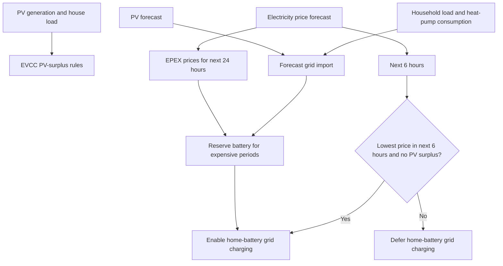

# evcc Price Optimization

[Deutsche Version](EVCC_PREISOPTIMIERUNG.md)

## 1. Responsibilities

1. **EVCC controls wallboxes and vehicles:** Vehicle detection, loadpoint assignment, charging targets and PV-surplus rules are managed entirely by EVCC. Home Assistant does not change wallbox modes, charging limits or EVCC priorities.
2. **Home Assistant optimizes only the home battery:** Grid charging is planned using the EPEX price forecast. A consumption forecast for household load and the heat pump helps reserve battery energy for expected expensive grid-import periods.
3. **Energy statistics remain unchanged:** Existing power and energy sources, meters and dashboard are not changed by this adjustment.

Battery optimization runs while `input_boolean.evcc_smart_price_optimizer` is enabled and the required data is available. Wallbox PV-surplus rules remain configurable in EVCC.

## 2. Overview

EVCC decides how the wallboxes charge. Home Assistant optimization affects only the home battery; permission to grid-charge does not guarantee that the battery will charge.

## 3. Implementation

### EVCC PV-Surplus Rules

PV-surplus priority and wallbox behavior are configured exclusively in EVCC. Home Assistant does not set `select.synboxen_priority_soc`, wallbox price limits or charging modes.

### Home Battery Grid Charging

Every minute, the automation compares the current planner price with the lowest price in the next six hours. When they match, grid charging can be enabled up to 100%. Grid charging is deferred when PV surplus is measured; hysteresis at 200 and 500 W reduces switching.

There is no separate low-SoC emergency refill. Grid charging still depends on the price check and available data when the battery is low.

### Save Battery Energy for Price Peaks

Every 30 seconds, the discharge-hold automation estimates grid import for the next 24 hours from the house load and PV forecast. Battery energy above 10% is allocated to the most expensive intervals. If the current price is sufficiently lower, evcc can temporarily block discharging with `hold`; a hold set by this automation is released when grid charging is enabled or active.

The 10% is a **planning reserve**. The actual backup reserve must be configured separately in the battery or evcc. The hold can influence when the battery discharges; it cannot guarantee enough energy for every later peak.

### Vehicle Detection in EVCC

Home Assistant no longer assigns vehicles. `select.synboxen_synbox_01_vehicle_name` reflects the vehicle selection reported by EVCC for that loadpoint; it is not an independent detection mechanism. If automatic detection fails, first check in the EVCC interface that `KillerMinion` is configured and that loadpoint `SynBox-01` supports and has vehicle detection enabled. Then inspect EVCC logs and the vehicle/loadpoint configuration. Manually selecting the vehicle in EVCC can test assignment, but does not fix the detection cause.

The EVCC server configuration and current EVCC logs are not present in this Home Assistant workspace, so the specific cause cannot be established here. A reliable diagnosis needs the EVCC loadpoint and vehicle configuration plus log messages from when the vehicle is connected.

### Heat-Pump and House-Load Forecast

Home Assistant learns hourly profiles for house load without the heat pump and heat-pump power per kelvin below 18 °C. These profiles and the hourly weather forecast produce a house-load forecast. For the current hour, measured outdoor temperature is used when a corresponding weather forecast and a valid measurement are available.

Without a suitable model or temperature forecast, the calculation falls back to the learned combined house-load profile; without that profile, it uses the 24-hour mean. New profiles need time and measurements to learn. Individual heat-pump starts and forecast errors remain uncertain.

### Missing Data and Price Limits

Home-battery grid charging requires valid measurements and a nearly six-hour price forecast. When the requirements are not met, grid charging is deferred. Wallbox control is independent and remains entirely in EVCC.

## 4. Setup and Checks

After reloading the Home Assistant configuration, review both wallbox price limits and the PV priority in EVCC. The former automations may have left values there; removing the automations does not reset EVCC settings. Set the desired limits and PV rules directly in EVCC.

1. Configure the planner tariff and the desired PV-surplus rules for both wallboxes in EVCC. Check `KillerMinion` vehicle detection at loadpoint `SynBox-01` in EVCC.
2. In Home Assistant, `number.synboxen_battery_grid_charge_limit` must be available. The weather, household-load, heat-pump and EPEX forecasts should provide valid values.
3. Configure the 10% backup reserve in the battery or EVCC. Enable `input_boolean.evcc_smart_price_optimizer`, then check the battery mode, grid-charge limit and forecasts under **Developer Tools → States**.

The switch pauses only battery price optimization. Existing battery limits are not automatically reset when it is turned off.

## 5. Energy Statistics Dashboard

The YAML dashboard in `lovelace_evcc_energie.yaml` shows energy flows and the electricity price. It is registered via `lovelace.dashboards.evcc-energie` in `configuration.yaml` and contains two ApexCharts cards:

| Card | Period | Content |
| --- | --- | --- |
| 14-day consumption statistics | daily values for the last 14 days | house excluding heat pump and wallboxes, heat pump, wallboxes, grid import, battery discharge and PV production |
| 24-hour energy consumption and grid price | last 24 hours in 15-minute intervals | the same energy flows and the planner grid price |

Daily values come from long-term statistics; the 24-hour card calculates differences from history. The two wallbox energy sources may differ slightly. Heat-pump energy and remaining house consumption are estimated from power measurements; delayed or missing readings can cause discrepancies. New counters are not backfilled.

Click a legend entry to hide or show a series; it may reappear on refresh. Chart height, colors, rendering and period can be adjusted in the YAML file. `custom:apexcharts-card` must be registered as the `/local/apexcharts-card.js?v=2.2.3` resource of type **JavaScript module** under **Settings → Dashboards → Resources**. YAML dashboard changes appear after reloading the page.