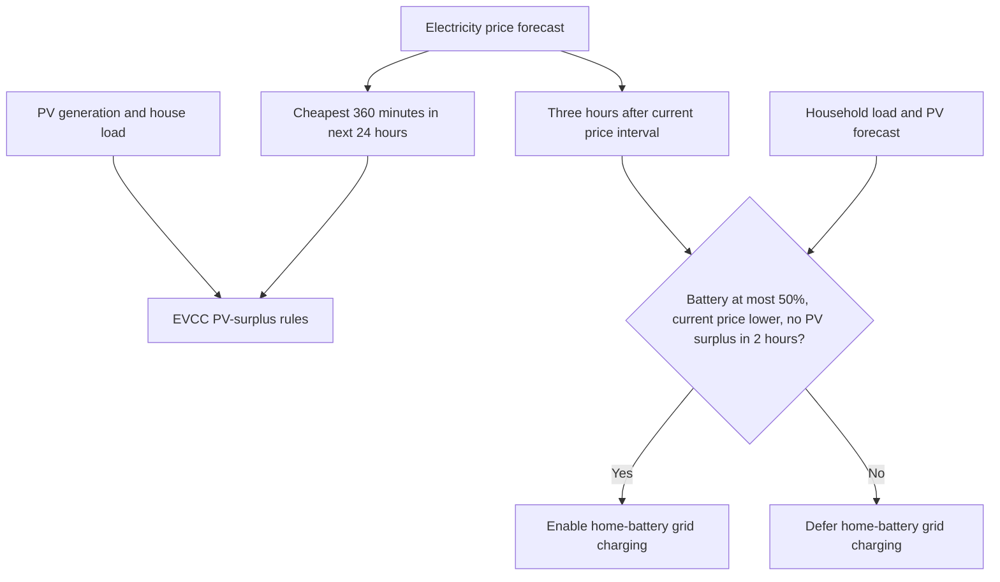

# evcc Price Optimization

[Deutsche Version](EVCC_PREISOPTIMIERUNG.md)

## 1. Responsibilities

1. **EVCC controls wallboxes and vehicles:** Vehicle detection, loadpoint assignment, charging targets and PV-surplus rules remain in EVCC. Home Assistant sets both wallbox smart charging price limits daily.
2. **Home Assistant optimizes the home battery:** The current grid price, state of charge, and PV and household-load forecasts determine the hourly grid-charging decision.
3. **Energy statistics remain unchanged:** Existing power and energy sources, meters and dashboard are not changed by this adjustment.

Battery optimization runs while `input_boolean.evcc_smart_price_optimizer` is enabled and the required data is available. Wallbox PV-surplus rules remain configurable in EVCC.

## 2. Overview

EVCC decides whether charging actually takes place; a price limit does not guarantee charging.

## 3. Implementation

### EVCC PV-Surplus Rules

PV-surplus priority and charging modes remain configured in EVCC. At 20:00 each day, Home Assistant selects the cheapest 360 minutes in the next 24 hours from the planner tariff. The highest selected price becomes both wallboxes' smart charging limit. Equal prices, rounding or long price intervals can allow more than 360 minutes; a price limit cannot specify exact charging times.

### Home Battery Grid Charging

On the hour, grid charging is enabled when the battery is at most 50% charged, no PV surplus over the hourly household-load forecast is expected in the next two hours, and the current planner price is strictly below every price in the three hours following the current price interval. The automation sets `input_number.evcc_battery_grid_charge_price` and the actual EVCC grid-charge limit to the current price, rounded up to the supported step. Otherwise only the EVCC grid-charge limit is set to the blocking value; the last planned price remains unchanged.

### Save Battery Energy for Price Peaks

The former automatic discharge hold is disabled. A hold it previously set is released at the next hourly check while battery optimization is enabled.

### Vehicle Detection in EVCC

Home Assistant no longer assigns vehicles. `select.synboxen_synbox_01_vehicle_name` reflects the vehicle selection reported by EVCC for that loadpoint; it is not an independent detection mechanism. If automatic detection fails, first check in the EVCC interface that `KillerMinion` is configured and that loadpoint `SynBox-01` supports and has vehicle detection enabled. Then inspect EVCC logs and the vehicle/loadpoint configuration. Manually selecting the vehicle in EVCC can test assignment, but does not fix the detection cause.

The EVCC server configuration and current EVCC logs are not present in this Home Assistant workspace, so the specific cause cannot be established here. A reliable diagnosis needs the EVCC loadpoint and vehicle configuration plus log messages from when the vehicle is connected.

### Heat-Pump and House-Load Forecast

Home Assistant learns hourly profiles for house load without the heat pump and heat-pump power per kelvin below 18 °C. These profiles and the hourly weather forecast produce a house-load forecast. For the current hour, measured outdoor temperature is used when a corresponding weather forecast and a valid measurement are available.

Without a suitable model or temperature forecast, the calculation falls back to the learned combined house-load profile; without that profile, it uses the 24-hour mean. New profiles need time and measurements to learn. Individual heat-pump starts and forecast errors remain uncertain.

### Missing Data and Price Limits

The wallbox calculation requires a complete 24-hour price forecast; otherwise both limits remain unchanged. The battery check requires valid charge and price readings, a full three-hour price forecast after the current interval, and two hours of PV and household-load forecasts. Missing data defers grid charging. PV surplus is a forecast, not a guarantee.

The blocking value is `-0.5 EUR/kWh`, the lowest configurable limit. At prices at or below this value it cannot reliably prevent grid charging. Enabled limits are rounded up to the EVCC step of `0.005 EUR/kWh`.

## 4. Setup and Checks

After reloading Home Assistant automations, check the forecasts and price limits. The first wallbox calculation runs at 20:00 and the first battery check on the next full hour.

1. Configure the planner tariff and the desired PV-surplus rules for both wallboxes in EVCC. Check `KillerMinion` vehicle detection at loadpoint `SynBox-01` in EVCC.
2. Both smart charging limits, `number.synboxen_battery_grid_charge_limit`, and the planner, PV and household-load forecasts must be available in Home Assistant.
3. Configure the desired backup reserve in the battery or EVCC. Enable `input_boolean.evcc_smart_price_optimizer`, then check the battery mode, grid-charge limit and forecasts under **Developer Tools → States**.

The switch pauses only battery price optimization; the wallbox calculation runs independently. Existing limits are not automatically reset when it is turned off.

## 5. Energy Statistics Dashboard

The YAML dashboard in `lovelace_evcc_energie.yaml` shows energy flows and the electricity price. It is registered via `lovelace.dashboards.evcc-energie` in `configuration.yaml` and contains two ApexCharts cards:

| Card | Period | Content |
| --- | --- | --- |
| 14-day consumption statistics | daily values for the last 14 days | house excluding heat pump and wallboxes, heat pump, wallboxes, grid import, battery discharge and PV production |
| 24-hour energy consumption and grid price | last 24 hours in 15-minute intervals | the same energy flows and the planner grid price |

Daily values come from long-term statistics; the 24-hour card calculates differences from history. The two wallbox energy sources may differ slightly. Heat-pump energy and remaining house consumption are estimated from power measurements; delayed or missing readings can cause discrepancies. New counters are not backfilled.

Click a legend entry to hide or show a series; it may reappear on refresh. Chart height, colors, rendering and period can be adjusted in the YAML file. `custom:apexcharts-card` must be registered as the `/local/apexcharts-card.js?v=2.2.3` resource of type **JavaScript module** under **Settings → Dashboards → Resources**. YAML dashboard changes appear after reloading the page.