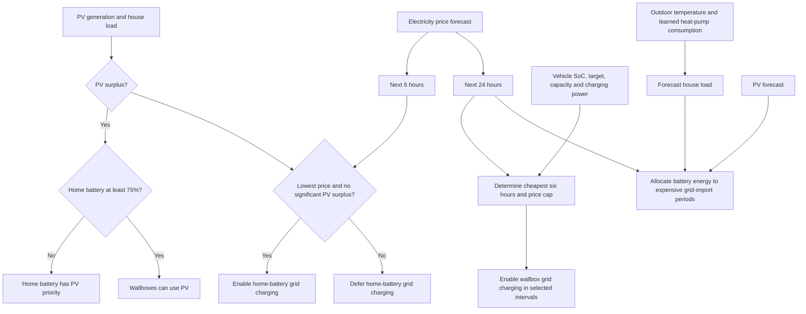

# evcc Price Optimization

[Deutsche Version](EVCC_PREISOPTIMIERUNG.md)

## 1. The Five Rules

1. **PV to the home battery first:** Solar power not needed by the house is used to charge the home battery first.
2. **Wallboxes from 75%:** Once the home battery is at least 75% charged, the wallboxes can also use surplus PV power.
3. **Charge the home battery cheaply and use it at price peaks:** When the current electricity price is the lowest in the next six hours, the battery is charged from the grid as needed. Its energy should mainly cover expensive periods.
4. **Charge vehicles cheaply:** A shared wallbox price cap is calculated from the cheapest six hours in the next 24 hours. Eligible intervals below the cap are selected for each connected vehicle based on its energy needs. Charging losses of about 5% are included; the cap can be adjusted manually.
5. **Account for the heat pump:** The consumption forecast uses learned heat-pump consumption and the outdoor temperature. Together with price and PV forecasts, it helps reserve battery energy for expensive periods.

These rules apply when price optimization is enabled and the necessary data is available. The following sections explain the requirements and limitations.

## 2. Overview

PV use, grid charging and discharge hold are separate decisions. The diagram shows their relationships; permission to charge does not guarantee that a device will charge.

## 3. Implementation

### PV Priority

When optimization is enabled, Home Assistant sets the evcc `select.synboxen_priority_soc` setting to 75%, if that option is available. Below 75%, the home battery has priority for PV surplus. At 75% and above, wallboxes can receive surplus; this does not categorically prevent the battery from charging from PV.

The wallbox plan also blocks grid charging when the home battery is below 75% and measured PV power exceeds house load. It uses `sensor.synboxen_pv_power` and `sensor.synboxen_home_power`. Wallboxes must run in evcc **Smart** mode.

### Home Battery Grid Charging

Every minute, the automation compares the current planner price with the lowest price in the next six hours. When they match, grid charging can be enabled up to 100%. Grid charging is deferred when PV surplus is measured; hysteresis at 200 and 500 W reduces switching.

There is no separate low-SoC emergency refill. Grid charging still depends on the price check and available data when the battery is low.

### Save Battery Energy for Price Peaks

Every 30 seconds, the discharge-hold automation estimates grid import for the next 24 hours from the house load and PV forecast. Battery energy above 10% is allocated to the most expensive intervals. If the current price is sufficiently lower, evcc can temporarily block discharging with `hold`; a hold set by this automation is released when grid charging is enabled or active.

The 10% is a **planning reserve**. The actual backup reserve must be configured separately in the battery or evcc. The hold can influence when the battery discharges; it cannot guarantee enough energy for every later peak.

### Vehicle Charging

Each wallbox is planned independently every minute. For a connected, recognized vehicle, the automation calculates the energy deficit from the effective target SoC, current vehicle SoC and usable battery capacity. The deficit is divided by `0.95` to account for approximately 5% charging losses. The configured charging power determines the required charging time.

Given a nearly complete 24-hour price forecast, the automation takes the highest price of the cheapest six hours, rounds it up and writes it to `input_number.evcc_wallbox_cost_limit`. Interval lengths are taken into account. Equal prices at the threshold or rounding can make more than six hours eligible. For each wallbox, the cheapest intervals are selected up to the required charging time and the shared price cap. Partial charging remains possible when there is not enough eligible time for the full demand. evcc stops charging at the configured vehicle target. The plan does not account for departure times and cannot guarantee charging by an earlier deadline.

The helper can be adjusted manually and applies to both wallboxes. The adjustment remains until the price forecast attribute changes, Home Assistant restarts or optimization is re-enabled, provided a sufficient forecast is then available. Individual wallbox limits may be lower or set to the blocking value because of charging demand and PV priority.

### Heat-Pump and House-Load Forecast

Home Assistant learns hourly profiles for house load without the heat pump and heat-pump power per kelvin below 18 °C. These profiles and the hourly weather forecast produce a house-load forecast. For the current hour, measured outdoor temperature is used when a corresponding weather forecast and a valid measurement are available.

Without a suitable model or temperature forecast, the calculation falls back to the learned combined house-load profile; without that profile, it uses the 24-hour mean. New profiles need time and measurements to learn. Individual heat-pump starts and forecast errors remain uncertain.

### Missing Data and Price Limits

Wallbox grid charging requires, among other things, a recognized vehicle, valid charging and PV measurements, a nearly complete 24-hour price forecast and at least one eligible interval. Home-battery grid charging requires valid measurements and nearly six hours of prices. When these requirements are not met, the respective automation sets its grid charging limit to the blocking value.

The blocking value is `-0.5 EUR/kWh`, the lowest configurable Smart price limit. At prices equal to or below it, grid charging cannot reliably be blocked. Release limits are rounded up to evcc's `0.005 EUR/kWh` step. If a limit entity is unavailable or invalid, the automation cannot change its existing value.

## 4. Setup and Checks

1. Configure an evcc planner tariff with electricity prices, set both wallboxes to **Smart**, and make their price limits and `select.synboxen_priority_soc` and `select.synboxen_battery_mode` available. The PV forecast should include both roof orientations.
2. Restart Home Assistant after changing the configuration so that the new helpers are created.
3. Set `input_number.evcc_killerminion_capacity` and `input_number.evcc_goldensnitch_capacity` to the vehicles' usable battery capacities in kWh. The mapping applies to evcc vehicles named `KillerMinion` and `GoldenSnitch`; other vehicle names require an automation change.
4. Set `input_number.evcc_synbox_01_charge_power` and `input_number.evcc_synbox_02_charge_power` to the available grid charging power in kW. Account for the vehicle, phases, current limits and load management; choose conservative values and update them when circumstances change.
5. Configure the 10% backup reserve in the battery or evcc. Enable `input_boolean.evcc_smart_price_optimizer`, then check vehicle assignments, measurements, price limits and the first control actions under **Developer Tools → States**.

The switch pauses optimization but does not automatically reset limits already written. `input_boolean.evcc_battery_refill_active` no longer controls the current plan.

## 5. Energy Statistics Dashboard

The YAML dashboard in `lovelace_evcc_energie.yaml` shows energy flows and the electricity price. It is registered via `lovelace.dashboards.evcc-energie` in `configuration.yaml` and contains two ApexCharts cards:

| Card | Period | Content |
| --- | --- | --- |
| 14-day consumption statistics | daily values for the last 14 days | house excluding heat pump and wallboxes, heat pump, wallboxes, grid import, battery discharge and PV production |
| 24-hour energy consumption and grid price | last 24 hours in 15-minute intervals | the same energy flows and the planner grid price |

Daily values come from long-term statistics; the 24-hour card calculates differences from history. The two wallbox energy sources may differ slightly. Heat-pump energy and remaining house consumption are estimated from power measurements; delayed or missing readings can cause discrepancies. New counters are not backfilled.

Click a legend entry to hide or show a series; it may reappear on refresh. Chart height, colors, rendering and period can be adjusted in the YAML file. `custom:apexcharts-card` must be registered as the `/local/apexcharts-card.js?v=2.2.3` resource of type **JavaScript module** under **Settings → Dashboards → Resources**. YAML dashboard changes appear after reloading the page.