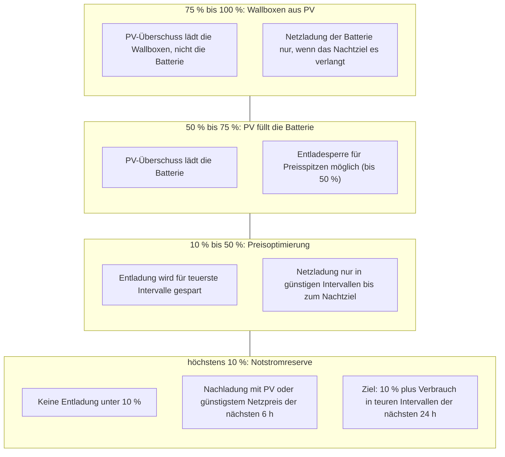
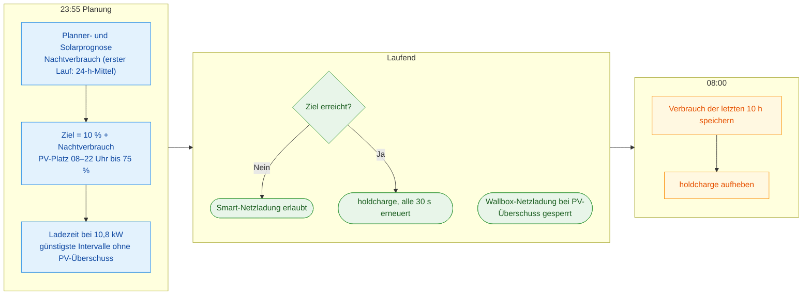

# evcc Preisoptimierung

[English version](EVCC_PREISOPTIMIERUNG.en.md)

## Voraussetzungen

- Der evcc Planner-Tarif muss auf Strompreise eingestellt sein.
- Die Entities `sensor.synboxen_forecast_planner` und `sensor.synboxen_forecast_solar` sind in Home Assistant aktiviert. Der Solar-Standortforecast von evcc sollte die in evcc eingerichteten Prognosen beider Dachflächen (SynSolar und SynSolar+) enthalten.
- Die Smart-Preisgrenzen von SynBox-01, SynBox-02 und der Hausbatterie müssen in evcc verfügbar sein.
- Der Helper `input_number.evcc_wallbox_cost_limit` muss aus `configuration.yaml` geladen sein. Er speichert den geplanten Wallbox-Grenzwert.
- Die Entität `select.synboxen_battery_mode` muss aktiviert sein, damit Home Assistant die zeitlich begrenzte Ladesperre erneuern kann.

## Bedienung

Der Schalter **evcc Preisoptimierung aktiv** (`input_boolean.evcc_smart_price_optimizer`) aktiviert oder pausiert die Automation. Er befindet sich unter den Helfern. Ein neu angelegter Schalter startet aus; Home Assistant stellt danach seinen letzten Zustand bei Neustarts wieder her.

Ist der Schalter eingeschaltet, berechnet die Automation täglich um 23:55 Uhr Preisgrenzen und ein Nachtziel für den Folgetag. Eine manuelle Ausführung berechnet die Werte sofort neu. Die EPEX-Day-ahead-Daten liegen um 23:55 Uhr typischerweise bereits vor. Die Preisoptimierung wertet das rollierende Zeitfenster der nächsten 24 Stunden aus:

- Wallboxen: Cutoff der günstigsten insgesamt vier Stunden außerhalb prognostizierter PV-Überschussintervalle. Ein Intervall wird ausgelassen, wenn die Solarprognose die Hausleistung des Stundenprofils um mehr als 500 W übersteigt; ohne Profil gilt das 24-Stunden-Mittel. Der berechnete Wert wird in `input_number.evcc_wallbox_cost_limit` gespeichert; die wirksamen evcc-Grenzen steuert eine separate Minuten-Automation.
- Hausbatterie: Der Ziel-Ladezustand berücksichtigt den durchschnittlichen Verbrauch der letzten Nacht, die aggregierte Solarprognose beider Dachflächen für den Folgetag von 08:00 bis 22:00 und die Notstromreserve von 10 % für den Zeitraum 22:00 bis 08:00. Da tagsüber ab 75 % Ladestand der PV-Überschuss die Wallboxen bedient, bietet die Batterie dem PV-Ertrag nur Platz bis 75 %. So wird genug nächtliche Energie eingeplant und zugleich Platz für den erwarteten PV-Ertrag gelassen. Der aktuelle Ladezustand und die Kapazität der Batterie werden berücksichtigt. Der Ladebedarf wird mit einer angenommenen Netz-Ladeleistung von 10,8 kW in die günstigsten Planner-Intervalle umgerechnet.

Der evcc-Planner-Forecast enthält bereits Aufschläge und MwSt. (Bruttopreis) und wird daher unverändert verwendet. Die Grenzwerte werden anschließend auf evccs Schrittweite von 0,005 €/kWh aufgerundet. evcc lädt im Modus „Smart“ aus dem Netz, wenn der Planner-Preis die jeweilige Grenze nicht überschreitet. Die Wallbox-PV-Automation sperrt die Netzladung bei mehr als 500 W gemessenem PV-Überschuss, indem sie beide Smart-Grenzen auf `-0,5` setzt. Unter 200 W Überschuss stellt sie den geplanten Wert aus `input_number.evcc_wallbox_cost_limit` wieder her. Die Hysterese verhindert häufiges Umschalten. Die aktuelle Überschussleistung wird als `sensor.synboxen_pv_power` minus `sensor.synboxen_home_power` berechnet.

Der Batterie-Scheduler prüft jede Minute, ob noch günstige Planner-Intervalle bis zum geplanten Batteriepreis verbleiben. Er gibt das Netzladelimit erst frei, wenn die verbleibende günstige Zeit bis zum nächsten 08:00 nur noch knapp für die benötigte Ladezeit bei 10,8 kW plus 30 Minuten Reserve reicht. So verzögern günstige Intervalle nach dem Nachtladefenster die Ladung nicht. Netzladung wird nicht gestartet, solange der gemessene PV-Überschuss über der Hysterese liegt. Sobald das Batterie-Ziel erreicht ist, setzt Home Assistant alle 30 Sekunden den evcc-Modus „Laden sperren“, der automatisch nach 60 Sekunden ausläuft. Unterhalb des Ziels wird die Sperre nicht erneuert; um 08:00 wird eine bestehende Sperre aufgehoben.

Das Sidebar-Dashboard **Energiestatistiken** visualisiert Verbrauch, Erzeugung und Netzpreis; Details stehen im Abschnitt [Dashboard Energiestatistiken](#dashboard-energiestatistiken). Der evcc-Hausleistungswert enthält die Wärmepumpe, aber nicht die Wallboxen; deren Leistung wird daher nicht nochmals abgezogen.

Um 08:00 speichert Home Assistant den aus der Hausleistung berechneten Verbrauch der vergangenen zehn Stunden als Basis. Um 23:55 wird dieser Wert auf die verbleibenden Stunden bis 08:00 skaliert. Zusätzlich erfassen drei 7-Tage-Statistiken nachts die evcc-Hausleistung (ohne Wallboxen) bei laufenden bzw. inaktiven Home-Connect-Geräten und die Zahl aktiver Geräte. Erst bei mindestens 99 % Zeitabdeckung wird daraus die typische Zusatzleistung pro Gerät geschätzt und mit den Restlaufzeiten aktiver Programme bis 08:00 hochgerechnet. Bis dahin bleibt die bisherige Verbrauchsschätzung aktiv. Beim ersten Lauf wird statt des gespeicherten Nachtwerts der 24-Stunden-Mittelwert verwendet. Die angenommene Ladeleistung ist ein gemessener Spitzenwert; ist die tatsächliche Ladeleistung niedriger, kann evcc mehr günstige Intervalle benötigen. Fehlt die Solarprognose oder enthält sie zu wenige Intervalle, berechnet die Batterieoptimierung das Ziel ohne PV-Aufnahmepuffer weiter (mindestens Nachtverbrauch plus 10 % Notstromreserve). Planner-Ausfall oder unzureichende günstige Intervalle können dagegen verhindern, dass ein neuer Preisgrenzwert geschrieben wird; in diesem Fall bleibt der zuletzt gespeicherte Wert erhalten. Das Ändern des Schalters wirkt bei der nächsten Berechnung.

Der Lauf um 23:55 legt den geplanten Batterie-Netzladepreis in `input_number.evcc_battery_grid_charge_price` und den geplanten Wallbox-Grenzwert in `input_number.evcc_wallbox_cost_limit` ab. Die Helper sind Planwerte, nicht zwingend die gerade aktiven evcc-Grenzen. Die Wallbox-Grenzen stehen in `number.synboxen_synbox_01_smart_cost_limit` und `number.synboxen_synbox_02_smart_cost_limit`; bei PV-Überschuss können sie vorübergehend auf `-0,5` stehen. Den Zustand und die Helper-Werte können Sie in Home Assistant unter **Entwicklerwerkzeuge → Zustände** prüfen. Eine manuelle Ausführung der täglichen Automation berechnet die Planwerte sofort neu.

## Dashboard Energiestatistiken

Das Dashboard ist in `lovelace_evcc_energie.yaml` definiert und wird in `configuration.yaml` unter `lovelace.dashboards.evcc-energie` als YAML-Dashboard eingebunden. Es besteht aus einer Panel-Ansicht (volle Breite) mit zwei untereinander angeordneten ApexCharts-Karten. Eine grafische Bearbeitung in Home Assistant ist für YAML-Dashboards nicht möglich; Änderungen erfolgen in der Datei und wirken nach dem Neuladen der Seite.

| Karte | Zeitraum | Inhalt |
| --- | --- | --- |
| 14-Tage-Verbrauchsstatistik (kWh) | letzte 14 Tage, Tageswerte, Säulen | Hausverbrauch ohne Wärmepumpe und Wallboxen, Wärmepumpe, Wallboxen, Netzbezug, Batterieentladung, PV-Produktion |
| 24-Stunden-Energieverbrauch und Netzpreis (15 min) | letzte 24 Stunden, je 15 Minuten | dieselben Größen als Energiedifferenz je Intervall; der Netzpreis (`sensor.synboxen_forecast_planner`) als Fläche auf einer eigenen €/kWh-Achse |

Die Tageswerte stammen aus den Langzeitstatistiken (`statistics` mit `type: change`, `period: day`). Die 24-Stunden-Karte berechnet die Differenz (`group_by.func: delta`) aus dem Verlauf. Die Wallbox-Energie stammt in der Tagesansicht aus `sensor.evcc_wallbox_energy_total`, in der 24-Stunden-Ansicht aus `sensor.evcc_wallbox_energy_integrated` (Integration der Wallbox-Leistung); beide Werte können leicht abweichen. Voraussetzung ist, dass alle verwendeten Entitäten Langzeitstatistiken führen (`state_class` gesetzt).

Wärmepumpenenergie und übriger Hausverbrauch sind Schätzungen aus der Integration der gemeldeten Leistung. Der Resthaus-Sensor zieht die Wärmepumpenleistung von der Hausleistung ab und begrenzt negative Differenzen auf null. Zeitversetzte Messungen, Abfrageintervalle, Ausfälle und nicht erfasste Nebenverbraucher können Abweichungen verursachen; bei fehlenden Eingangswerten ist der Resthaus-Sensor nicht verfügbar. Die neuen Zähler und Statistiken beginnen erst nach dem Neustart, sie werden nicht rückwirkend befüllt. Die bisherigen Gesamthaus-Statistiken bleiben erhalten, waren aber während Wallboxladung durch den früheren doppelten Abzug zu niedrig. Tages- und Monatszähler der Wärmepumpe verwenden den neuen Schätzzähler. Home Assistant nach der Konfigurationsänderung neu starten und danach die Sensoren und Diagramme prüfen.

### Bedienung

- Ein Klick auf einen Legendeneintrag blendet die Serie dauerhaft aus bzw. wieder ein (`apex_config.legend.onItemClick.toggleDataSeries`).
- Das Überfahren eines Legendeneintrags hebt die Serie hervor (`apex_config.legend.onItemHover.highlightDataSeries`).
- Ausgeblendete Serien werden bei einer Aktualisierung (`update_interval`) möglicherweise wieder eingeblendet.

### Anpassung

| Einstellung | Ort in der YAML-Datei |
| --- | --- |
| Diagrammhöhe (Standard 420 px) | `apex_config.chart.height` je Karte |
| Serienfarbe | `color` je Serie |
| Flächen-/Liniendarstellung | `type` (`area`, `line`, `column`) je Serie |
| Linienstärke, Flächendeckkraft | `stroke_width`, `opacity` je Serie |
| Aktualisierung | `update_interval` je Karte |
| Zeitraum der Tagesansicht | `graph_span` der ersten Karte |

Die Karte `custom:apexcharts-card` muss als Dashboard-Ressource `/local/apexcharts-card.js?v=2.2.3` (Typ **JavaScript-Modul**) unter **Einstellungen → Dashboards → Ressourcen** registriert sein. Der Eintrag unter `lovelace.resources` in `configuration.yaml` genügt im Storage-Modus nicht; fehlt die Ressource, zeigt die Karte „Konfigurationsfehler“. Ein globales `chart_type` auf Kartenebene überschreibt die `type`-Angaben der einzelnen Serien und sollte nicht gesetzt werden.

## Entladesperre für Preisspitzen

Solange der Schalter **evcc Preisoptimierung aktiv** eingeschaltet ist, prüft eine weitere Automation alle 30 Sekunden, ob die Entladung der Hausbatterie gesperrt werden soll. Sie ordnet den Restvorrat oberhalb der Notstromreserve von 10 % den teuersten Intervallen der nächsten 24 Stunden zu. Als Netzbezug je Intervall gilt der mittlere Hausverbrauch (`sensor.evcc_hausleistung_24h_mittel`) abzüglich der PV-Prognose. Der niedrigste Preis dieser Intervalle ist die Preisspitzen-Schwelle.

- Die Entladung wird gesperrt (evcc-Modus `hold`), wenn die Batterie bei 50 % oder darunter mit mehr als 100 W entlädt und der aktuelle Preis um mehr als 0,02 €/kWh unter der Schwelle liegt.
- Die Sperre wird alle 30 Sekunden erneuert, weil evcc den Modus nach 60 Sekunden zurücksetzt.
- Sie wird aufgehoben, sobald der aktuelle Preis die Schwelle erreicht, der Ladestand 10 % unterschreitet oder 50 % überschreitet.
- Der Helper `input_boolean.evcc_battery_discharge_hold` merkt sich, dass die Sperre von dieser Automation stammt. Nur dann wird sie wieder aufgehoben.
- Hat die Nachtladung-Begrenzung `holdcharge` gesetzt, greift die Automation nicht ein.

Startgrenze (50 %), Reserve (10 %) und Abstand (0,02 €/kWh) stehen als Variablen am Anfang der Automation.

## Nachladen bei leerer Hausbatterie

Der Batterie-Scheduler startet zusätzlich eine Nachladung, sobald der Ladestand 10 % oder weniger beträgt. Der Helper `input_boolean.evcc_battery_refill_active` merkt sich den aktiven Zustand.

- Als Ziel gilt 10 % plus der erwartete Netzbezug (Hausverbrauch abzüglich PV-Prognose) der nächsten 24 Stunden in Intervallen, die mehr als 0,03 €/kWh über dem günstigsten Preis der nächsten 6 Stunden liegen (maximal 100 %).
- Die PV-Prognose des Fensters (nächste 6 Stunden) wird zuerst angerechnet, höchstens jedoch bis zu einem Ladestand von 75 %; nur der Rest wird aus dem Netz geladen.
- Dafür werden die günstigsten Intervalle des Fensters ohne PV-Überschuss gewählt (Ladeleistung 10,8 kW). Das Netzladelimit wird auf den Preis des teuersten gewählten Intervalls gesetzt, sodass nur in günstigen Intervallen geladen wird.
- Bei gemessenem PV-Überschuss wird nicht aus dem Netz geladen.
- Die Nachladung endet beim Erreichen des Ziels. Solange sie aktiv ist, setzt die Nachtladung-Begrenzung kein `holdcharge`.
- Die Nachladung ist unabhängig vom Nachtziel; die Werte `refill_soc`, `refill_window_hours` und `refill_margin` stehen am Anfang des Schedulers.

## Tageszeitabhängiges Hausverbrauchsprofil

Home Assistant lernt die Hausleistung einschließlich Wärmepumpe, aber ohne Wallboxen, je Uhrzeit. Eine Automation schreibt stündlich den Mittelwert der letzten Stunde (`sensor.evcc_hausleistung_1h_mittel`) mit 30 % Gewicht in `input_text.evcc_hausleistung_profil` (24 kommagetrennte Watt-Werte, Index = Stunde). Beim ersten Lauf werden unbekannte Stunden mit dem ersten Messwert gefüllt; das Profil nähert sich in einigen Tagen der Realität an. Nachladung, Entladesperre und die PV-Überschussprüfung der täglichen Preisplanung verwenden je Intervall den Profilwert statt des 24-h-Mittels. Das Profil enthält die Wärmepumpe bereits; ein zusätzlicher Aufschlag würde sie doppelt zählen. Ist das Profil leer, gilt das 24-h-Mittel. Nach der Korrektur der Hauslast benötigt das bestehende Profil einige Tage, um sich anzupassen; einzelne Wärmepumpenstarts sind nicht vorhersagbar.

## Temperaturabhängige Wärmepumpenprognose

Stündlich lernt Home Assistant je Uhrzeit die Hausleistung ohne Wärmepumpe (`input_text.evcc_haus_ohne_wp_profil`) und die Wärmepumpenleistung je Kelvin unter 18 °C Außentemperatur (`input_text.evcc_wp_kelvin_profil`). `sensor.evcc_prognose_aussentemperatur_24h` kombiniert beides mit der Stundenprognose von `weather.forecast_home` und liefert im Attribut `profile` die erwartete Hausleistung je Uhrzeit. Stunden mit weniger als 3 K Heizbedarf, ohne Prognose oder ohne gelerntes Modell nutzen weiter das Gesamtprofil. Fehlt das Attribut, gilt ebenfalls das Gesamtprofil.

## Ladeziel nach Teuerbedarf

Das Nachtziel der täglichen Planung ist mindestens das bisherige Ziel, mindestens aber 10 % plus der erwartete Netzbezug (Hausprofil abzüglich PV-Prognose, geteilt durch 0,9 Entladewirkungsgrad) in allen Intervallen bis zum ersten PV-Überschuss, die mehr als 0,03 €/kWh über dem Ladepreis liegen. Ladepreis und Ziel hängen voneinander ab und werden in vier Durchläufen bestimmt. Das Ziel wird auf den Ladestand begrenzt, der in den günstigen Intervallen bis zum PV-Überschuss erreichbar ist.

## Regeln nach Ladestand

Die Batterie hält dauerhaft 10 % als Notstromreserve. Tagsüber wird PV-Überschuss nur bis 75 % in die Batterie geladen; darüber werden die Wallboxen aus dem PV-Überschuss bedient. In der Kalkulation gilt daher:

- Mindestziel für die Nacht: 10 % Notstromreserve plus Nachtverbrauch.
- PV-Aufnahmeraum der Batterie: nur bis 75 % statt bis 100 %. Das Nachtziel lautet `75 % − PV-Ertrag (in %) + Nachtverbrauch`, mindestens jedoch das Mindestziel.
- Entladesperre: nutzbarer Restvorrat ist alles oberhalb von 10 %.
- Nachladung: PV-Anteil höchstens bis 75 % anrechnen; darüber liefert der Überschuss keine Batterieladung mehr.

## Ablauf

## Konfiguration

Der Helper ist in `configuration.yaml` definiert; die Automation liegt in `automations.yaml`. Die von ihr verwendeten Entity-IDs sind:

- `sensor.synboxen_forecast_planner`
- `number.synboxen_synbox_01_smart_cost_limit`
- `number.synboxen_synbox_02_smart_cost_limit`
- `number.synboxen_battery_grid_charge_limit`
- `sensor.synboxen_forecast_solar`
- `sensor.synboxen_battery_soc`
- `sensor.synboxen_battery_capacity`
- `select.synboxen_battery_mode`
- `input_number.evcc_night_consumption_kwh`
- `input_number.evcc_wallbox_cost_limit`
- `input_number.evcc_battery_grid_charge_price`
- `input_number.evcc_battery_target_soc`
- `sensor.synboxen_pv_power`
- `sensor.synboxen_home_power`
- `sensor.synboxen_battery_power`
- `sensor.evcc_hausleistung_24h_mittel`
- `input_boolean.evcc_battery_discharge_hold`
