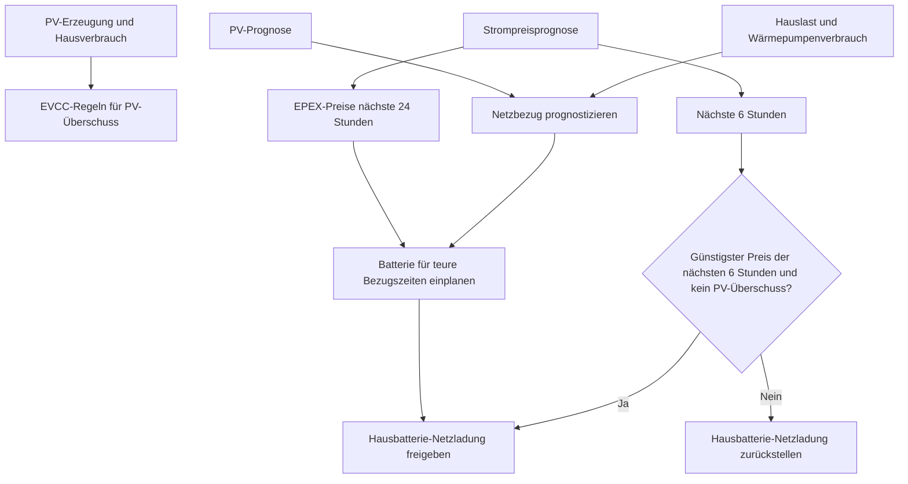

# evcc Preisoptimierung

[English version](EVCC_PREISOPTIMIERUNG.en.md)

## 1. Zuständigkeiten

1. **EVCC steuert Wallboxen und Fahrzeuge:** Fahrzeugerkennung, Ladepunktzuordnung, Ladeziele und PV-Überschussregeln liegen vollständig in EVCC. Home Assistant ändert weder Wallbox-Modi noch Ladegrenzen oder EVCC-Prioritäten.
2. **Home Assistant optimiert nur die Hausbatterie:** Die Netzladung wird anhand der EPEX-Preisprognose geplant. Eine Verbrauchsprognose aus Hauslast und Wärmepumpe hilft, Batteriereserven für erwartete teure Netzbezugszeiten einzuplanen.
3. **Energiestatistiken bleiben unverändert:** Bestehende Leistungs- und Energiequellen, Zähler und Dashboard werden von der Umstellung nicht verändert.

Die Batterieoptimierung läuft bei eingeschaltetem Schalter `input_boolean.evcc_smart_price_optimizer` und verfügbaren Daten. Die PV-Überschussregeln der Wallboxen werden ausschließlich in EVCC festgelegt und sind dort einstellbar.

## 2. Grafische Übersicht

EVCC entscheidet über die Wallboxladung. Die Home-Assistant-Optimierung beeinflusst ausschließlich die Hausbatterie; eine Netzladefreigabe garantiert nicht, dass die Batterie tatsächlich lädt.

## 3. Umsetzung

### PV-Überschussregeln in EVCC

Die Priorität für PV-Überschuss und das Verhalten der Wallboxen werden ausschließlich in EVCC konfiguriert. Home Assistant setzt weder `select.synboxen_priority_soc` noch Wallbox-Preisgrenzen oder Lademodi.

### Hausbatterie aus dem Netz laden

Jede Minute vergleicht die Automation den aktuellen Planner-Preis mit dem niedrigsten Preis der nächsten sechs Stunden. Entspricht er diesem Minimum, kann die Batterie bis 100 % aus dem Netz laden. Bei gemessenem PV-Überschuss wird die Netzladung zurückgestellt; eine Hysterese mit 200 und 500 W reduziert häufiges Umschalten.

Eine Sondernachladung bei niedrigem Ladestand ist nicht aktiv. Die Netzladung bleibt auch bei niedrigem Ladestand von der Preisprüfung und den verfügbaren Daten abhängig.

### Batterieenergie für Preisspitzen sparen

Alle 30 Sekunden berechnet die Entladesperre den erwarteten Netzbezug der nächsten 24 Stunden aus Hauslast und PV-Prognose. Der Batterievorrat oberhalb von 10 % wird rechnerisch den teuersten Intervallen zugeordnet. Liegt der aktuelle Preis ausreichend darunter, kann evcc die Batterieentladung vorübergehend mit `hold` sperren; bei freigegebener oder aktiver Netzladung wird die von dieser Automation gesetzte Sperre aufgehoben.

Die 10 % sind eine **Planungsreserve**. Die tatsächliche Notstromreserve muss separat in der Batterie oder in evcc eingerichtet sein. Die Sperre kann nur beeinflussen, wann die Batterie entlädt; sie garantiert nicht, dass genug Energie für alle späteren Spitzen vorhanden ist.

### Fahrzeugerkennung in EVCC

Home Assistant ordnet Fahrzeuge nicht mehr selbst zu. `select.synboxen_synbox_01_vehicle_name` zeigt die von EVCC für den Ladepunkt gelieferte Fahrzeugauswahl; es ist keine unabhängige Erkennung. Prüfe bei fehlender automatischer Erkennung zuerst in der EVCC-Oberfläche, ob `KillerMinion` als Fahrzeug angelegt ist und ob der Ladepunkt `SynBox-01` eine Erkennung unterstützt und aktiviert hat. Danach EVCC-Logs und die Fahrzeug-/Ladepunktkonfiguration prüfen. Ein manuelles Auswählen in EVCC kann die Zuordnung testen, ersetzt aber nicht die Ursachenbehebung der Erkennung.

Die EVCC-Serverkonfiguration und aktuelle EVCC-Logs liegen nicht in diesem Home-Assistant-Workspace. Deshalb lässt sich die konkrete Ursache hier nicht sicher bestimmen. Für eine belastbare Diagnose werden die EVCC-Loadpoint- und Fahrzeugkonfiguration sowie die Logmeldungen beim Anstecken benötigt.

### Wärmepumpen- und Hauslastprognose

Home Assistant lernt stündliche Profile für die Hausleistung ohne Wärmepumpe und die Wärmepumpenleistung je Kelvin unter 18 °C. Daraus und aus der stündlichen Wettervorhersage entsteht eine Hauslastprognose. Für die aktuelle Stunde wird die gemessene Außentemperatur verwendet, sofern ein passender Wetterprognosewert und eine gültige Messung vorliegen.

Fehlen ein geeignetes Modell oder eine Temperaturprognose, fällt die Berechnung auf das erlernte Gesamtlastprofil zurück; fehlt auch dieses, wird der 24-Stunden-Mittelwert verwendet. Neue Profile müssen zunächst durch Messungen lernen. Einzelne Wärmepumpenstarts und Prognosefehler bleiben unsicher.

### Fehlende Daten und Preisgrenzen

Für die Batterie-Netzfreigabe werden gültige Messwerte und nahezu sechs Stunden Preisprognose benötigt. Bei fehlenden Voraussetzungen wird die Netzladung zurückgestellt. Die Wallboxsteuerung ist davon unabhängig und verbleibt vollständig in EVCC.

Der Sperrwert beträgt `-0,5 €/kWh`, die kleinste einstellbare Smart-Preisgrenze. Bei Strompreisen auf oder unter diesem Wert kann er die Netzladung nicht zuverlässig sperren. Freigabegrenzen werden auf die evcc-Schrittweite von `0,005 €/kWh` aufgerundet. Bei nicht erreichbarer oder ungültiger Grenzwert-Entität kann die Automation den bestehenden Wert nicht ändern.

## 4. Einrichtung und Kontrolle

Nach dem Neuladen der Home-Assistant-Konfiguration in EVCC die bestehenden Preisgrenzen beider Wallboxen und die PV-Priorität prüfen. Die früheren Automationen können dort Werte hinterlassen haben; das Entfernen der Automationen setzt diese EVCC-Werte nicht zurück. Gewünschte Grenzen und PV-Regeln direkt in EVCC einstellen.

1. In EVCC den Planner-Tarif und die gewünschten PV-Überschussregeln für beide Wallboxen konfigurieren. Die Fahrzeugerkennung für `KillerMinion` am Ladepunkt `SynBox-01` in EVCC prüfen.
2. In Home Assistant muss `number.synboxen_battery_grid_charge_limit` verfügbar sein. Die Wetter-, Hauslast-, Wärmepumpen- und EPEX-Prognosen sollten gültige Werte liefern.
3. Die 10-%-Notstromreserve in der Batterie oder in EVCC konfigurieren. Anschließend `input_boolean.evcc_smart_price_optimizer` einschalten und Batterie-Modus, Netzladegrenze und Prognosen unter **Entwicklerwerkzeuge → Zustände** prüfen.

Der Schalter pausiert ausschließlich die Batterie-Preisoptimierung. Bereits geschriebene Batteriegrenzen werden beim Ausschalten nicht automatisch zurückgesetzt.

## 5. Dashboard Energiestatistiken

Das YAML-Dashboard in `lovelace_evcc_energie.yaml` zeigt die Energieflüsse und den Netzpreis. Es wird über `lovelace.dashboards.evcc-energie` in `configuration.yaml` eingebunden und besteht aus zwei ApexCharts-Karten:

| Karte | Zeitraum | Inhalt |
| --- | --- | --- |
| 14-Tage-Verbrauchsstatistik | Tageswerte der letzten 14 Tage | Haus ohne Wärmepumpe und Wallboxen, Wärmepumpe, Wallboxen, Netzbezug, Batterieentladung und PV-Produktion |
| 24-Stunden-Energieverbrauch und Netzpreis | letzte 24 Stunden in 15-Minuten-Intervallen | dieselben Energieflüsse und der Planner-Netzpreis |

Tageswerte stammen aus Langzeitstatistiken; die 24-Stunden-Karte bildet Differenzen aus dem Verlauf. Die beiden Wallbox-Energiequellen können leicht voneinander abweichen. Wärmepumpenenergie und übriger Hausverbrauch sind aus Leistungsmessungen geschätzt; Messverzögerungen oder Ausfälle können Abweichungen verursachen. Neue Zähler werden nicht rückwirkend befüllt.

Ein Klick auf die Legende blendet eine Serie ein oder aus; beim Aktualisieren kann sie wieder erscheinen. Diagrammhöhe, Farben, Darstellung und Zeitraum lassen sich in der YAML-Datei anpassen. `custom:apexcharts-card` muss als Ressource `/local/apexcharts-card.js?v=2.2.3` vom Typ **JavaScript-Modul** unter **Einstellungen → Dashboards → Ressourcen** registriert sein. Änderungen am YAML-Dashboard werden nach dem Neuladen der Seite sichtbar.