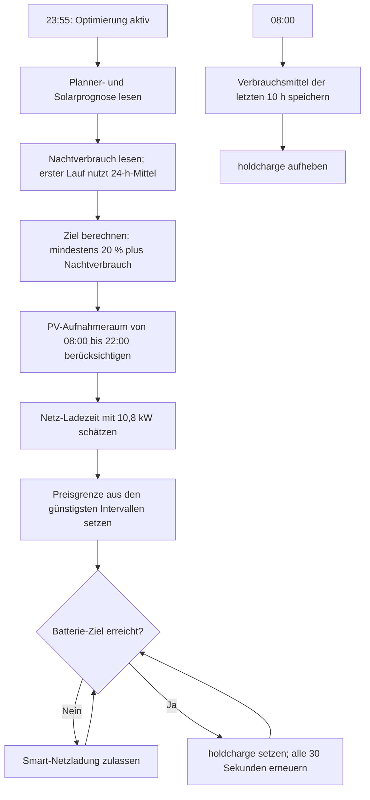

# evcc Preisoptimierung

[English version](EVCC_PREISOPTIMIERUNG.en.md)

## Voraussetzungen

- Der evcc Planner-Tarif muss auf Strompreise eingestellt sein.
- Die Entities `sensor.synboxen_forecast_planner` und `sensor.synboxen_forecast_solar` sind in Home Assistant aktiviert. Der Solar-Standortforecast von evcc sollte die in evcc eingerichteten Prognosen beider Dachflächen (SynSolar und SynSolar+) enthalten.
- Die Smart-Preisgrenzen von SynBox-01, SynBox-02 und der Hausbatterie müssen in evcc verfügbar sein.
- Die Entität `select.synboxen_battery_mode` muss aktiviert sein, damit Home Assistant die zeitlich begrenzte Ladesperre erneuern kann.

## Bedienung

Der Schalter **evcc Preisoptimierung aktiv** (`input_boolean.evcc_smart_price_optimizer`) aktiviert oder pausiert die Automation. Er befindet sich unter den Helfern. Ein neu angelegter Schalter startet aus; Home Assistant stellt danach seinen letzten Zustand bei Neustarts wieder her.

Ist der Schalter eingeschaltet, berechnet die Automation täglich um 23:55 Uhr Preisgrenzen und ein Nachtziel für den Folgetag. Die EPEX-Day-ahead-Daten liegen dann typischerweise bereits vor. Die Preisoptimierung wertet das rollierende Zeitfenster der nächsten 24 Stunden aus:

- Wallboxen: Cutoff der günstigsten insgesamt vier Stunden. Derselbe Wert wird auf SynBox-01 und SynBox-02 gesetzt.
- Hausbatterie: Der Ziel-Ladezustand berücksichtigt den durchschnittlichen Verbrauch der letzten Nacht, die aggregierte Solarprognose beider Dachflächen für den Folgetag von 08:00 bis 22:00 und eine Mindestreserve von 20 % für den Zeitraum 22:00 bis 08:00. So wird genug nächtliche Energie eingeplant und zugleich Platz für den erwarteten PV-Ertrag gelassen. Der aktuelle Ladezustand und die Kapazität der Batterie werden berücksichtigt. Der Ladebedarf wird mit einer angenommenen Netz-Ladeleistung von 10,8 kW in die günstigsten Planner-Intervalle umgerechnet.

Der evcc-Planner-Forecast enthält bereits Aufschläge und MwSt. (Bruttopreis) und wird daher unverändert verwendet. Die Grenzwerte werden anschließend auf evccs Schrittweite von 0,005 €/kWh aufgerundet. evcc lädt im Modus „Smart“ aus dem Netz, wenn der Planner-Preis die jeweilige Grenze nicht überschreitet. Sobald das Batterie-Ziel erreicht ist, setzt Home Assistant alle 30 Sekunden den evcc-Modus „Laden sperren“, der automatisch nach 60 Sekunden ausläuft. Unterhalb des Ziels wird die Sperre nicht erneuert; um 08:00 wird eine bestehende Sperre aufgehoben.

Um 08:00 speichert Home Assistant den aus der Hausleistung berechneten Verbrauch der vergangenen zehn Stunden als Basis. Um 23:55 wird dieser Wert auf die verbleibenden Stunden bis 08:00 skaliert. Zusätzlich erfassen drei 7-Tage-Statistiken nachts die Fronius-Hausleistung bei laufenden bzw. inaktiven Home-Connect-Geräten und die Zahl aktiver Geräte. Erst bei mindestens 99 % Zeitabdeckung wird daraus die typische Zusatzleistung pro Gerät geschätzt und mit den Restlaufzeiten aktiver Programme bis 08:00 hochgerechnet. Bis dahin bleibt die bisherige Verbrauchsschätzung aktiv. Beim ersten Lauf wird statt des gespeicherten Nachtwerts der 24-Stunden-Mittelwert verwendet. Die angenommene Ladeleistung ist ein gemessener Spitzenwert; ist die tatsächliche Ladeleistung niedriger, kann evcc mehr günstige Intervalle benötigen. Bei fehlendem Forecast, zu wenigen Prognoseintervallen oder ungültigen Preisgrenzen bleiben die bisherigen Preisgrenzen unverändert und das Nachtziel wird auf 0 gesetzt. Das Ändern des Schalters wirkt bei der nächsten Berechnung.

Der Lauf um 23:55 legt nur den geplanten Netzladepreis in `input_number.evcc_battery_grid_charge_price` ab. Eine weitere Automation prüft jede Minute, wie viele Minuten mit einem Preis bis zu diesem Limit noch vor uns liegen. Das evcc-Netzladelimit wird erst freigegeben, wenn diese Zeit nur noch knapp (Ladedauer bei 10,8 kW plus 30 Minuten Reserve) für das Batterieziel reicht, und danach wieder deaktiviert. So versorgt die Batterie bei langen günstigen Phasen das Haus und wird erst kurz vor deren Ende aufgeladen, statt dauerhaft in `charge` zu stehen.

## Entladesperre für Preisspitzen

Solange der Schalter **evcc Preisoptimierung aktiv** eingeschaltet ist, prüft eine weitere Automation alle 30 Sekunden, ob die Entladung der Hausbatterie gesperrt werden soll. Sie ordnet den Restvorrat oberhalb von 20 % den teuersten Intervallen der nächsten 24 Stunden zu. Als Netzbezug je Intervall gilt der mittlere Hausverbrauch (`sensor.evcc_hausleistung_24h_mittel`) abzüglich der PV-Prognose. Der niedrigste Preis dieser Intervalle ist die Preisspitzen-Schwelle.

- Die Entladung wird gesperrt (evcc-Modus `hold`), wenn die Batterie bei 50 % oder darunter mit mehr als 100 W entlädt und der aktuelle Preis um mehr als 0,02 €/kWh unter der Schwelle liegt.
- Die Sperre wird alle 30 Sekunden erneuert, weil evcc den Modus nach 60 Sekunden zurücksetzt.
- Sie wird aufgehoben, sobald der aktuelle Preis die Schwelle erreicht, der Ladestand 20 % unterschreitet oder 50 % überschreitet.
- Der Helper `input_boolean.evcc_battery_discharge_hold` merkt sich, dass die Sperre von dieser Automation stammt. Nur dann wird sie wieder aufgehoben.
- Hat die Nachtladung-Begrenzung `holdcharge` gesetzt, greift die Automation nicht ein.

Startgrenze (50 %), Reserve (20 %) und Abstand (0,02 €/kWh) stehen als Variablen am Anfang der Automation.

## Ablauf

## Konfiguration

Der Helper ist in `configuration.yaml` definiert; die Automation liegt in `automations.yaml`. Die von ihr verwendeten Entity-IDs sind:

- `sensor.synboxen_forecast_planner`
- `number.synboxen_synbox_01_smart_cost_limit`
- `number.synboxen_synbox_02_smart_cost_limit`
- `number.synboxen_battery_grid_charge_limit`
- `sensor.synboxen_forecast_solar`
- `sensor.solarnet_leistung_verbrauch`
- `sensor.synboxen_battery_soc`
- `sensor.synboxen_battery_capacity`
- `select.synboxen_battery_mode`
- `input_number.evcc_night_consumption_kwh`
- `input_number.evcc_battery_target_soc`
- `sensor.synboxen_battery_power`
- `sensor.evcc_hausleistung_24h_mittel`
- `input_boolean.evcc_battery_discharge_hold`
