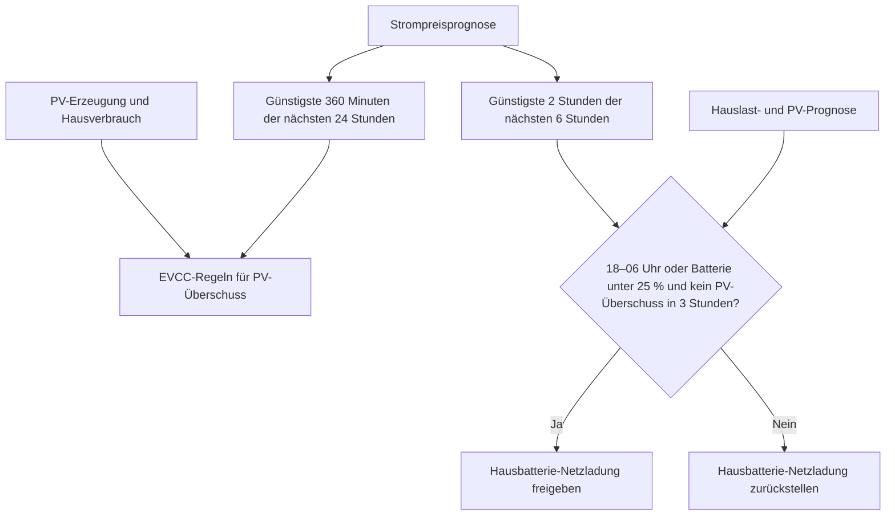

# evcc Preisoptimierung

[English version](EVCC_PREISOPTIMIERUNG.en.md)

## 1. Zuständigkeiten

1. **EVCC steuert Wallboxen und Fahrzeuge:** Fahrzeugerkennung, Ladepunktzuordnung, Ladeziele und PV-Überschussregeln bleiben in EVCC. Home Assistant setzt täglich die Smartlade-Preisgrenzen beider Wallboxen.
2. **Home Assistant optimiert die Hausbatterie:** Der aktuelle Netzpreis, der Ladestand sowie PV- und Hauslastprognosen entscheiden stündlich über die Netzladefreigabe.
3. **Energiestatistiken bleiben unverändert:** Bestehende Leistungs- und Energiequellen, Zähler und Dashboard werden von der Umstellung nicht verändert.

Die Batterieoptimierung läuft bei eingeschaltetem Schalter `input_boolean.evcc_smart_price_optimizer` und verfügbaren Daten. Die PV-Überschussregeln der Wallboxen werden ausschließlich in EVCC festgelegt und sind dort einstellbar.

## 2. Grafische Übersicht

EVCC entscheidet über die tatsächliche Ladung; eine Preisfreigabe garantiert keine Ladung.

## 3. Umsetzung

### PV-Überschussregeln in EVCC

Die Priorität für PV-Überschuss und die Lademodi werden weiterhin in EVCC konfiguriert. Täglich um 20:00 Uhr und bei jedem Anschluss an eine der beiden Wallboxen ermittelt Home Assistant die günstigsten 360 Minuten innerhalb der nächsten 24 Stunden aus dem Planner-Tarif. Der höchste Preis dieser Auswahl wird auf beide Smartladegrenzen gesetzt. Bei Preisgleichstand, durch Rundung oder bei langen Preisintervallen können mehr als 360 Minuten freigegeben werden; eine Preisgrenze legt keine exakten Ladezeiten fest.

Beim Anschluss schaltet Home Assistant den jeweiligen EVCC-Ladepunkt für 15 Minuten auf `now`, damit EVCC das Fahrzeug während eines tatsächlichen Ladevorgangs erkennen kann. Danach wird auf `smart` zurückgeschaltet, sofern das Fahrzeug noch angeschlossen ist; beim Abstecken erfolgt die Rückschaltung sofort. `now` kann während dieser Zeit unabhängig vom Preislimit laden. Die Automatik garantiert nicht, dass EVCC das Fahrzeug erkennt oder korrekt zuordnet.

### Hausbatterie aus dem Netz laden

Zur vollen Stunde ermittelt die Automation aus den nächsten sechs Stunden die günstigsten zwei Stunden und setzt `input_number.evcc_battery_grid_charge_price` sowie die EVCC-Netzladegrenze auf den höchsten Preis dieser Auswahl, auf die Schrittweite aufgerundet. Von 18:00 bis 06:00 Uhr gilt dies unabhängig von Ladestand und PV-Prognose; von 06:00 bis 18:00 Uhr nur bei einem Ladestand unter 25 % und wenn in den nächsten drei Stunden kein PV-Überschuss gegenüber der prognostizierten Hauslast erwartet wird. Andernfalls wird nur die EVCC-Netzladegrenze auf den Sperrwert gesetzt; der zuletzt geplante Preis bleibt erhalten. EVCC steuert die Ladung anhand der Preisgrenze auch innerhalb der Stunde. Gleichstände, Rundung oder längere Preisintervalle können mehr als zwei Stunden freigeben. Die Auswahl wird stündlich mit einem neuen rollierenden Fenster berechnet; zwei Stunden sind keine garantierte Ladedauer oder Vollladung.

### Batterieenergie für Preisspitzen sparen

Bei einem SoC oberhalb des einstellbaren Grenzwerts darf die Hausbatterie jederzeit entladen. Am Grenzwert und darunter wird die Entladung auf die konfigurierbare Anzahl der teuersten Stunden im konfigurierbaren Preisprognosefenster beschränkt. Standardwerte sind 65 %, vier Stunden und zwölf Stunden. Die Regel hält den Batteriemodus außerhalb dieser Preisfenster auf `hold` und gibt ihn in den ausgewählten Stunden wieder frei. Während aktiver Netzladung greift die Entladesperre nicht. Bei ungültiger oder unvollständiger Preisprognose bleibt die Entladung unterhalb der SoC-Grenze gesperrt; bei deaktivierter Preisoptimierung wird eine eigene Sperre aufgehoben.

Grenzwert, Anzahl der teuren Stunden und Prognosezeitraum können zusammen mit `input_boolean.evcc_smart_price_optimizer` im Dashboard **Energiestatistiken** angepasst werden. Die Auswahl bewertet Preisintervalle anhand ihrer Dauer; bei gleich teuren Intervallen entscheidet die Reihenfolge der Prognose.

### Fahrzeugerkennung in EVCC

Home Assistant ordnet Fahrzeuge nicht mehr selbst zu. `select.synboxen_synbox_01_vehicle_name` zeigt die von EVCC für den Ladepunkt gelieferte Fahrzeugauswahl; es ist keine unabhängige Erkennung. Prüfe bei fehlender automatischer Erkennung zuerst in der EVCC-Oberfläche, ob `KillerMinion` als Fahrzeug angelegt ist und ob der Ladepunkt `SynBox-01` eine Erkennung unterstützt und aktiviert hat. Danach EVCC-Logs und die Fahrzeug-/Ladepunktkonfiguration prüfen. Ein manuelles Auswählen in EVCC kann die Zuordnung testen, ersetzt aber nicht die Ursachenbehebung der Erkennung.

Die EVCC-Serverkonfiguration und aktuelle EVCC-Logs liegen nicht in diesem Home-Assistant-Workspace. Deshalb lässt sich die konkrete Ursache hier nicht sicher bestimmen. Für eine belastbare Diagnose werden die EVCC-Loadpoint- und Fahrzeugkonfiguration sowie die Logmeldungen beim Anstecken benötigt.

### Wärmepumpen- und Hauslastprognose

Home Assistant lernt stündliche Profile für die Hausleistung ohne Wärmepumpe und die Wärmepumpenleistung je Kelvin unter 18 °C. Daraus und aus der stündlichen Wettervorhersage entsteht eine Hauslastprognose. Für die aktuelle Stunde wird die gemessene Außentemperatur verwendet, sofern ein passender Wetterprognosewert und eine gültige Messung vorliegen.

Fehlen ein geeignetes Modell oder eine Temperaturprognose, fällt die Berechnung auf das erlernte Gesamtlastprofil zurück; fehlt auch dieses, wird der 24-Stunden-Mittelwert verwendet. Neue Profile müssen zunächst durch Messungen lernen. Einzelne Wärmepumpenstarts und Prognosefehler bleiben unsicher.

### Fehlende Daten und Preisgrenzen

Die Wallboxberechnung benötigt eine vollständige 24-Stunden-Preisprognose; sonst bleiben beide Grenzen unverändert. Die Batterieprüfung benötigt sechs vollständige Stunden Preisprognose; tagsüber zusätzlich einen gültigen Ladestand sowie drei Stunden PV- und Hauslastprognose. Fehlen die jeweils benötigten Daten, wird die Netzladung zurückgestellt. PV-Überschuss ist nur eine Prognose und keine Garantie.

Der Sperrwert beträgt `-0,5 €/kWh`, die kleinste einstellbare Smart-Preisgrenze. Bei Strompreisen auf oder unter diesem Wert kann er die Netzladung nicht zuverlässig sperren. Freigabegrenzen werden auf die evcc-Schrittweite von `0,005 €/kWh` aufgerundet. Bei nicht erreichbarer oder ungültiger Grenzwert-Entität kann die Automation den bestehenden Wert nicht ändern.

## 4. Einrichtung und Kontrolle

Nach dem Neuladen der Home-Assistant-Automationen die Prognosen und Preisgrenzen prüfen. Die Wallboxberechnung erfolgt täglich um 20:00 Uhr und zusätzlich beim Anschluss; die erste Batterieprüfung erfolgt zur nächsten vollen Stunde.

1. In EVCC den Planner-Tarif und die gewünschten PV-Überschussregeln für beide Wallboxen konfigurieren. Die Fahrzeugerkennung für `KillerMinion` am Ladepunkt `SynBox-01` in EVCC prüfen.
2. In Home Assistant müssen beide Smartladegrenzen, `number.synboxen_battery_grid_charge_limit`, Planner-, PV- und Hauslastprognose verfügbar sein.
3. Die gewünschte Notstromreserve in der Batterie oder EVCC konfigurieren. `input_boolean.evcc_smart_price_optimizer` einschalten und Batterie-Modus, Netzladegrenze und Prognosen unter **Entwicklerwerkzeuge → Zustände** prüfen.

Der Schalter pausiert ausschließlich die Batterie-Preisoptimierung; die Wallboxberechnung läuft unabhängig davon. Bereits geschriebene Grenzen werden beim Ausschalten nicht automatisch zurückgesetzt.

## 5. Dashboard Energiestatistiken

Das YAML-Dashboard in `lovelace_evcc_energie.yaml` zeigt die Energieflüsse und den Netzpreis. Es wird über `lovelace.dashboards.evcc-energie` in `configuration.yaml` eingebunden und besteht aus zwei ApexCharts-Karten:

| Karte | Zeitraum | Inhalt |
| --- | --- | --- |
| 14-Tage-Verbrauchsstatistik | Tageswerte der letzten 14 Tage | Haus ohne Wärmepumpe und Wallboxen, Wärmepumpe, Wallboxen, Netzbezug, Batterieentladung und PV-Produktion |
| 24-Stunden-Energieverbrauch und Netzpreis | letzte 24 Stunden in 15-Minuten-Intervallen | dieselben Energieflüsse und der Planner-Netzpreis |

Tageswerte stammen aus Langzeitstatistiken; die 24-Stunden-Karte bildet Differenzen aus dem Verlauf. Die beiden Wallbox-Energiequellen können leicht voneinander abweichen. Wärmepumpenenergie und übriger Hausverbrauch sind aus Leistungsmessungen geschätzt; Messverzögerungen oder Ausfälle können Abweichungen verursachen. Neue Zähler werden nicht rückwirkend befüllt.

Ein Klick auf die Legende blendet eine Serie ein oder aus; beim Aktualisieren kann sie wieder erscheinen. Diagrammhöhe, Farben, Darstellung und Zeitraum lassen sich in der YAML-Datei anpassen. `custom:apexcharts-card` muss als Ressource `/local/apexcharts-card.js?v=2.2.3` vom Typ **JavaScript-Modul** unter **Einstellungen → Dashboards → Ressourcen** registriert sein. Änderungen am YAML-Dashboard werden nach dem Neuladen der Seite sichtbar.