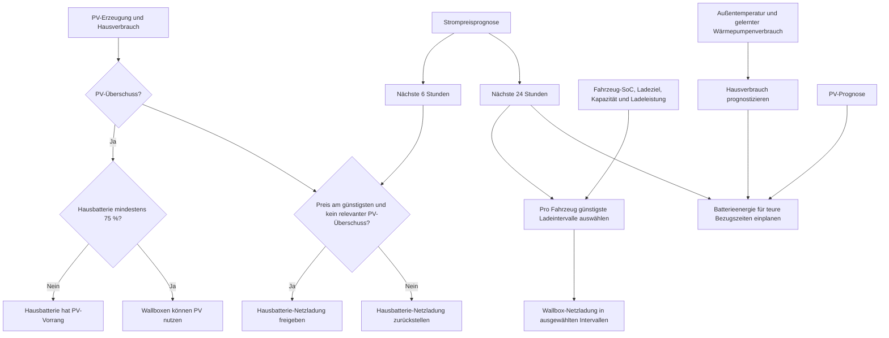

# evcc Preisoptimierung

[English version](EVCC_PREISOPTIMIERUNG.en.md)

## 1. Die fünf Regeln

1. **PV zuerst in die Hausbatterie:** Sonnenstrom, den das Haus nicht benötigt, lädt vorrangig die Hausbatterie.
2. **Wallboxen ab 75 %:** Sobald die Hausbatterie mindestens zu 75 % geladen ist, können auch die Wallboxen PV-Überschuss nutzen.
3. **Hausbatterie günstig laden und bei Preisspitzen nutzen:** Ist der Strom jetzt am günstigsten innerhalb der nächsten sechs Stunden, wird die Batterie bei Bedarf aus dem Netz geladen. Ihre Energie soll vor allem teure Zeiten abdecken.
4. **Fahrzeuge günstig laden:** Für ein angeschlossenes Fahrzeug werden die günstigsten Ladezeiten der nächsten 24 Stunden anhand seines Ladebedarfs ermittelt. Etwa 5 % Ladeverluste werden berücksichtigt.
5. **Wärmepumpe berücksichtigen:** Die Verbrauchsprognose nutzt die gelernten Wärmepumpenverbräuche und die Außentemperatur. Zusammen mit der Preis- und PV-Prognose hilft sie, Batterieenergie für teure Zeiten einzuplanen.

Diese Regeln gelten bei eingeschalteter Preisoptimierung und verfügbaren Daten. Die konkreten Voraussetzungen und Grenzen stehen in den folgenden Abschnitten.

## 2. Grafische Übersicht

PV-Nutzung, Netzladung und Entladesperre sind getrennte Entscheidungen. Die Grafik zeigt ihre Zusammenhänge; eine Netzfreigabe garantiert nicht, dass die Geräte tatsächlich laden.

## 3. Umsetzung

### PV-Vorrang

Bei aktivierter Optimierung setzt Home Assistant die evcc-Einstellung `select.synboxen_priority_soc` auf 75 %, sofern diese Option verfügbar ist. Unterhalb von 75 % hat die Hausbatterie beim PV-Überschuss Vorrang. Ab 75 % können Wallboxen Überschuss erhalten; die Batterie wird dadurch nicht grundsätzlich vom PV-Laden ausgeschlossen.

Zusätzlich sperrt die Wallboxplanung die Netzfreigabe, wenn die Hausbatterie unter 75 % liegt und PV-Leistung über dem Hausverbrauch gemessen wird. Hierfür verwendet sie `sensor.synboxen_pv_power` und `sensor.synboxen_home_power`. Die Wallboxen müssen in evcc im Modus **Smart** betrieben werden.

### Hausbatterie aus dem Netz laden

Jede Minute vergleicht die Automation den aktuellen Planner-Preis mit dem niedrigsten Preis der nächsten sechs Stunden. Entspricht er diesem Minimum, kann die Batterie bis 100 % aus dem Netz laden. Bei gemessenem PV-Überschuss wird die Netzladung zurückgestellt; eine Hysterese mit 200 und 500 W reduziert häufiges Umschalten.

Eine Sondernachladung bei niedrigem Ladestand ist nicht aktiv. Die Netzladung bleibt auch bei niedrigem Ladestand von der Preisprüfung und den verfügbaren Daten abhängig.

### Batterieenergie für Preisspitzen sparen

Alle 30 Sekunden berechnet die Entladesperre den erwarteten Netzbezug der nächsten 24 Stunden aus Hauslast und PV-Prognose. Der Batterievorrat oberhalb von 10 % wird rechnerisch den teuersten Intervallen zugeordnet. Liegt der aktuelle Preis ausreichend darunter, kann evcc die Batterieentladung vorübergehend mit `hold` sperren; bei freigegebener oder aktiver Netzladung wird die von dieser Automation gesetzte Sperre aufgehoben.

Die 10 % sind eine **Planungsreserve**. Die tatsächliche Notstromreserve muss separat in der Batterie oder in evcc eingerichtet sein. Die Sperre kann nur beeinflussen, wann die Batterie entlädt; sie garantiert nicht, dass genug Energie für alle späteren Spitzen vorhanden ist.

### Fahrzeugladung planen

Jede Wallbox wird minütlich und unabhängig geplant. Für ein angeschlossenes, erkanntes Fahrzeug berechnet die Automation den Energiebedarf aus der Differenz zwischen effektivem Ladeziel und Fahrzeug-Ladestand sowie der nutzbaren Batteriekapazität. Der Bedarf wird durch `0,95` geteilt, um rund 5 % Ladeverluste einzurechnen. Aus der eingestellten Ladeleistung ergibt sich die benötigte Ladezeit.

Die Automation wählt die preisgünstigsten Intervalle der nächsten 24 Stunden, bis diese Ladezeit erreicht ist. Bei gleichen Preisen am Grenzwert können zusätzliche Intervalle freigegeben werden. evcc beendet die Ladung am eingestellten Fahrzeugziel. Die Planung berücksichtigt keine Abfahrtszeit und gewährleistet daher keine Ladung bis zu einem früheren Termin.

### Wärmepumpen- und Hauslastprognose

Home Assistant lernt stündliche Profile für die Hausleistung ohne Wärmepumpe und die Wärmepumpenleistung je Kelvin unter 18 °C. Daraus und aus der stündlichen Wettervorhersage entsteht eine Hauslastprognose. Für die aktuelle Stunde wird die gemessene Außentemperatur verwendet, sofern ein passender Wetterprognosewert und eine gültige Messung vorliegen.

Fehlen ein geeignetes Modell oder eine Temperaturprognose, fällt die Berechnung auf das erlernte Gesamtlastprofil zurück; fehlt auch dieses, wird der 24-Stunden-Mittelwert verwendet. Neue Profile müssen zunächst durch Messungen lernen. Einzelne Wärmepumpenstarts und Prognosefehler bleiben unsicher.

### Fehlende Daten und Preisgrenzen

Für die Wallbox-Netzfreigabe sind unter anderem ein erkanntes Fahrzeug, gültige Lade- und PV-Daten, eine weitgehend vollständige 24-Stunden-Preisprognose sowie genügend Ladezeit im Fenster erforderlich. Für die Batterie-Netzfreigabe werden gültige Messwerte und nahezu sechs Stunden Preisprognose benötigt. Fehlen diese Voraussetzungen, setzt die jeweilige Automation den Netzladegrenzwert auf den Sperrwert.

Der Sperrwert beträgt `-0,5 €/kWh`, die kleinste einstellbare Smart-Preisgrenze. Bei Strompreisen auf oder unter diesem Wert kann er die Netzladung nicht zuverlässig sperren. Freigabegrenzen werden auf die evcc-Schrittweite von `0,005 €/kWh` aufgerundet. Bei nicht erreichbarer oder ungültiger Grenzwert-Entität kann die Automation den bestehenden Wert nicht ändern.

## 4. Einrichtung und Kontrolle

1. In evcc den Planner-Tarif mit Strompreisen konfigurieren, beide Wallboxen auf **Smart** stellen und die Preisgrenzen sowie `select.synboxen_priority_soc` und `select.synboxen_battery_mode` verfügbar machen. Die PV-Prognose sollte beide Dachflächen enthalten.
2. Home Assistant nach den Konfigurationsänderungen neu starten, damit die neuen Helfer angelegt werden.
3. `input_number.evcc_killerminion_capacity` und `input_number.evcc_goldensnitch_capacity` auf die nutzbaren Fahrzeugbatteriekapazitäten in kWh setzen. Die Zuordnung gilt für die in evcc erkannten Fahrzeuge `KillerMinion` und `GoldenSnitch`; andere Fahrzeugnamen erfordern eine Anpassung der Automation.
4. `input_number.evcc_synbox_01_charge_power` und `input_number.evcc_synbox_02_charge_power` auf die verfügbare Netzladeleistung in kW setzen. Fahrzeug, Phasen, Strombegrenzung und Lastmanagement berücksichtigen; Werte konservativ wählen und bei Änderungen anpassen.
5. Die 10-%-Notstromreserve in der Batterie oder in evcc konfigurieren. Anschließend `input_boolean.evcc_smart_price_optimizer` einschalten und Fahrzeugzuordnung, Messwerte, Preisgrenzen und erste Schaltungen unter **Entwicklerwerkzeuge → Zustände** prüfen.

Der Schalter pausiert die Optimierung, setzt aber bereits geschriebene Grenzwerte nicht automatisch zurück. `input_number.evcc_wallbox_cost_limit` und `input_boolean.evcc_battery_refill_active` steuern die aktuelle Planung nicht mehr.

## 5. Dashboard Energiestatistiken

Das YAML-Dashboard in `lovelace_evcc_energie.yaml` zeigt die Energieflüsse und den Netzpreis. Es wird über `lovelace.dashboards.evcc-energie` in `configuration.yaml` eingebunden und besteht aus zwei ApexCharts-Karten:

| Karte | Zeitraum | Inhalt |
| --- | --- | --- |
| 14-Tage-Verbrauchsstatistik | Tageswerte der letzten 14 Tage | Haus ohne Wärmepumpe und Wallboxen, Wärmepumpe, Wallboxen, Netzbezug, Batterieentladung und PV-Produktion |
| 24-Stunden-Energieverbrauch und Netzpreis | letzte 24 Stunden in 15-Minuten-Intervallen | dieselben Energieflüsse und der Planner-Netzpreis |

Tageswerte stammen aus Langzeitstatistiken; die 24-Stunden-Karte bildet Differenzen aus dem Verlauf. Die beiden Wallbox-Energiequellen können leicht voneinander abweichen. Wärmepumpenenergie und übriger Hausverbrauch sind aus Leistungsmessungen geschätzt; Messverzögerungen oder Ausfälle können Abweichungen verursachen. Neue Zähler werden nicht rückwirkend befüllt.

Ein Klick auf die Legende blendet eine Serie ein oder aus; beim Aktualisieren kann sie wieder erscheinen. Diagrammhöhe, Farben, Darstellung und Zeitraum lassen sich in der YAML-Datei anpassen. `custom:apexcharts-card` muss als Ressource `/local/apexcharts-card.js?v=2.2.3` vom Typ **JavaScript-Modul** unter **Einstellungen → Dashboards → Ressourcen** registriert sein. Änderungen am YAML-Dashboard werden nach dem Neuladen der Seite sichtbar.